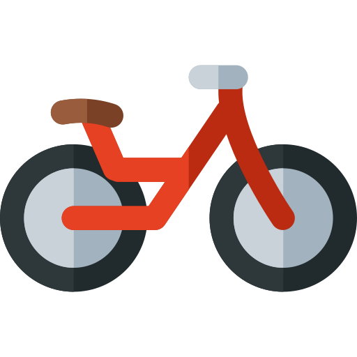
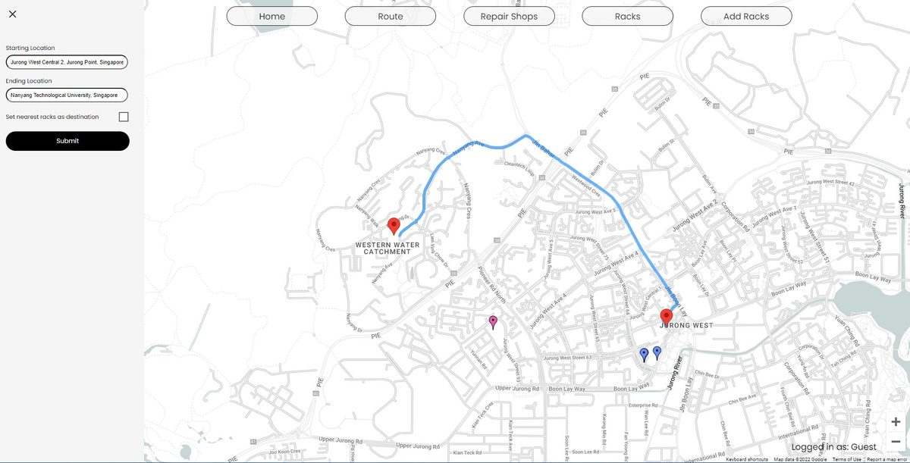
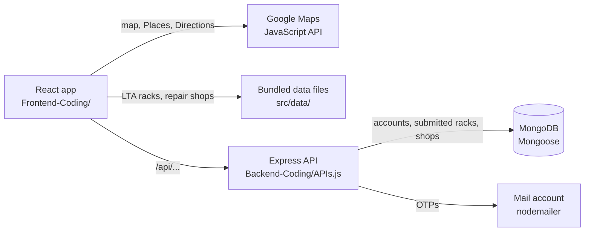
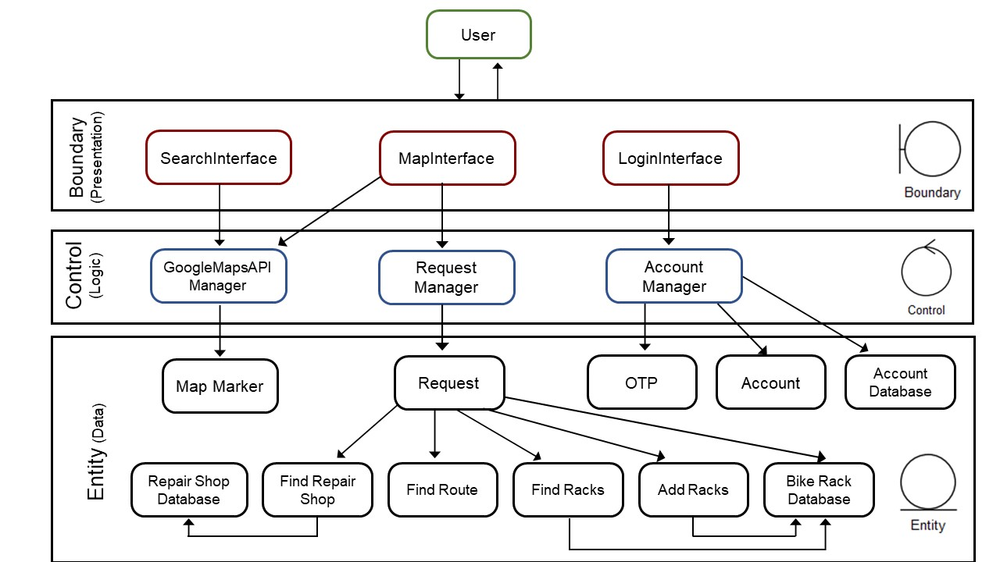
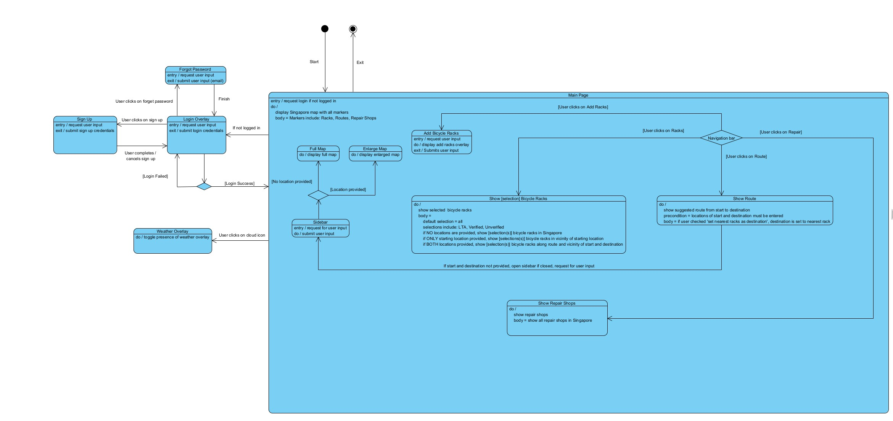

<div align="center">



<h1>myBikeSG</h1>

<p><strong>Bicycle racks, repair shops and cycling routes in Singapore, on one map.</strong></p>

<p>A web app for cyclists. It shows public bicycle racks and bike repair shops on a Google Map,<br>
plans cycling routes, and lets signed-in users submit new rack locations.</p>

[](#team) [](#status) [](Frontend-Coding/package.json) [](Backend-Coding/APIs.js) [](#what-it-does) [](https://github.com/xitij27/myBikeSG/commits/main)

<p>
  <a href="#what-it-does"><strong>What it does</strong></a>
  &nbsp;&nbsp;|&nbsp;&nbsp;
  <a href="#running-it-locally">Run it locally</a>
  &nbsp;&nbsp;|&nbsp;&nbsp;
  <a href="#api">API</a>
  &nbsp;&nbsp;|&nbsp;&nbsp;
  <a href="#design">Design diagrams</a>
</p>



<sub>A cycling route from Jurong West to Nanyang Technological University, planned as a guest.</sub>

</div>

<br>

## What it does

- **Map of bicycle racks.** Public racks come from LTA's bicycle-rack dataset ([`Frontend-Coding/src/data/lta-bicycle-rack-geojson.json`](Frontend-Coding/src/data/lta-bicycle-rack-geojson.json)). Racks that users submitted are loaded from the backend.
- **Bike repair shops** are loaded from [`Frontend-Coding/src/data/bike_repair.json`](Frontend-Coding/src/data/bike_repair.json).
- **Cycling directions** between a start and an end point use the Google Maps Directions service in bicycling mode. Place search uses Google Places autocomplete. One option sets the nearest rack as the destination.
- **Accounts:** sign up, log in and reset the password, with a one-time password sent by email. Guests can use the map without an account.
- **Add a rack:** signed-in users can submit a rack location, which is stored in MongoDB.

## How it works



The app draws the map and plans routes with Google Maps in the browser, and
reads the public racks and repair shops from files bundled with it. Accounts
and user-submitted racks go through the Express API to MongoDB.

## Design

The system architecture, as designed for the course:



<table>
  <tr>
    <td width="33%" valign="top">
      <a href="Use%20Case%20Diagram/Use%20Case%20Diagram1.jpg"></a>
      <h3>Use cases</h3>
      <sub><a href="Use%20Case%20Diagram/">Use Case Diagram/</a></sub>
    </td>
    <td width="33%" valign="top">
      <a href="UML%20Class%20Diagram/UMLclassdiagram.jpg"></a>
      <h3>Classes</h3>
      <sub><a href="UML%20Class%20Diagram/">UML Class Diagram/</a></sub>
    </td>
    <td width="33%" valign="top">
      <a href="DialogMap/DialogMap_updated01042022.jpg"></a>
      <h3>Dialog map</h3>
      <sub><a href="DialogMap/">DialogMap/</a>, with two earlier versions</sub>
    </td>
  </tr>
</table>

Sequence diagrams for finding routes, racks and repair shops, signing up,
logging in and resetting a password are in
[`sequencediagrams/`](sequencediagrams/). The JSDoc for the backend classes
is in [`Documentation/out/`](Documentation/out/).

## Repository layout

| Path | Contents |
|------|----------|
| [`Frontend-Coding/`](Frontend-Coding/) | React app (Create React App) |
| [`Backend-Coding/`](Backend-Coding/) | Express API (`APIs.js`) with MongoDB through Mongoose, and email OTPs through nodemailer |
| [`Backend-Coding/Project/`](Backend-Coding/Project/) | An earlier stand-alone login and registration prototype using an in-memory user list |
| `application skeleton/` | The skeleton the backend classes started from |
| [`Documentation/out/`](Documentation/out/) | Generated JSDoc for the backend classes |
| `DialogMap/`, `UML Class Diagram/`, `Use Case Diagram/`, `sequencediagrams/` | Design diagrams from the course labs |

## Running it locally

You need Node.js, a MongoDB database (for example a free MongoDB Atlas
cluster), a mail account for sending OTPs, and a Google Maps JavaScript API key
with the Places and Directions APIs enabled.

**1. Start the backend.**

```bash
cd Backend-Coding
cp .env.example .env      # then fill in MONGODB_URI, EMAIL_USER and EMAIL_PASS
npm install
node --env-file=.env APIs.js
```

The API listens on port 9000 unless `PORT` is set.

> [!NOTE]
> `--env-file` needs Node 20.6 or later. On older versions, set the variables in your shell and run `npm start` instead.

**2. Start the frontend.**

```bash
cd Frontend-Coding
cp .env.example .env.local   # then fill in REACT_APP_GOOGLE_MAPS_API_KEY
npm install
npm start
```

The app opens on <http://localhost:3000> and talks to the backend at
`http://localhost:9000`. Set `REACT_APP_API_URL` to use a different address.

## API

All routes are served by [`Backend-Coding/APIs.js`](Backend-Coding/APIs.js).
Errors come back as HTTP 500 with `"Database Error"`.

| Method | Route | Body / params | Returns |
|--------|-------|---------------|---------|
| GET | `/api/sendOTP/:reset/:email/` | `reset` is `0` for sign-up and `1` for password reset | Emails an OTP. Refuses if the email is already registered (sign-up) or not registered (reset) |
| POST | `/api/signUp/` | `email`, `password`, `otp`, `dob`, `name` | `"Email already in use"`, `"true"` or `"false"` |
| POST | `/api/login/` | `email`, `password` | `"Login Success"` or `"Incorrect Password"` |
| POST | `/api/resetPassword/` | `email`, `password`, `otp` | `"Password has been changed"`, 404 if there is no account, or a wrong-OTP message |
| GET | `/api/bikeRacks` | — | All user-submitted racks |
| POST | `/api/addRacks` | `rack_id`, `user_email`, `lat`, `long`, `verified` | `"Already in Database"` or `"Your request has been submitted!"` |
| GET | `/api/repairShops` | — | All repair shops in the database |
| POST | `/api/addRepairShops` | `shop_id`, `contact`, `lat`, `long`, `name` | `"Already in Database"` or `"true"` |

> [!TIP]
> Call `/api/sendOTP/...` before `/api/signUp/` or `/api/resetPassword/`, because the OTP is generated and checked in server memory.

## Status

> [!IMPORTANT]
> This is a 2022 coursework prototype. Passwords are SHA-256-hashed in the browser and stored and compared as that unsalted hash. OTPs live in server memory, so a restart forgets them.

The original deployments are no longer complete: the backend was on Heroku,
which has been shut down. Run both parts locally to try the app.

## Team

Built for NTU's CZ2006 Software Engineering course (February–April 2022) by
Darryl Ng, Harsh Rao D, Aryan Madan, Sanskar Malavade, Kshitij Parashar (team
leader) and Spencer.

<br>

<div align="center">
<sub><a href="#what-it-does">What it does</a> &nbsp;|&nbsp; <a href="#running-it-locally">Run it locally</a> &nbsp;|&nbsp; <a href="#api">API</a> &nbsp;|&nbsp; <a href="#design">Design</a> &nbsp;|&nbsp; <a href="https://github.com/xitij27/myBikeSG/issues">Issues</a></sub>
</div>
